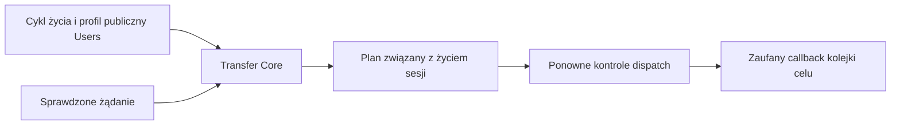

# Transfer Core — alpha-0.6.1

**Bieżący etap — alpha-0.6.4:** [Connection Routing](CONNECTION_ROUTING.md) łączy przyjmowanie i dostarczanie D/E CTM oraz RCM we wspólnym routerze SID, jednym typie niezmiennego pakietu i jednej ścieżce ograniczonych kolejek. Odbiorcami są ustalone okresy życia gotowych sesji: D tylko cel, E cel i niezależne echo źródła. Token nie wybiera odbiorców; zachowano role, walidację, błędy i prywatność. Testy równoległych par używają tego samego tokenu bez mieszania odbiorców.

**Etap dostarczony w alpha-0.6.3:** [ADC RCM](ADC_RCM.md) dodaje własną walidację D/E żądań odwrotnych i routing celu/echa przez Transfer Core, z pasywnym źródłem/aktywnym celem dla rodziny, kontrolą życia/adresu i wspólnymi kolejkami. CTM/RCM współdzielą walidację pól. Rzeczywisty ncdc sprawdza RCM→CTM i handshake obu ról; bez rejestru tokenów oczekujących i obsługi danych plików.

**Etap dostarczony w alpha-0.6.2:** [ADC CTM](ADC_CTM.md) dodaje własną walidację D/E CTM i rzeczywisty routing celu/echa przez Transfer Core, z kontrolą aktywności TCP źródła, życia/adresu, wspólnymi ograniczonymi kolejkami i handshake rzeczywistego ncdc. Protokół/port/token/rozszerzenia zachowują sprawdzony zapis i prywatność. RCM i dane plików pozostają kolejnymi etapami.

**Lokalna walidacja alpha-0.6.1 (2026-11-13):** Wszystkie **124/124 zestawy CTest** przeszły w Debug, Release i ASan/UBSan z wymaganymi narzędziami i domyślnym wykrywaniem wycieków, w tym błędy/czasy życia Transfer Core, granice ADC/ADCS, rzeczywista odmowa listy plików ncdc i działający po niej czat, dotychczasowe Search/UDP, MariaDB i Apache HTTPS. Końcowy test zachowania próby i przenoszenia planu ponownie przeszedł w Debug i Release. Brak ostrzeżeń kompilatora. Przeszły build/typecheck WebAdmin, **12 testów Node**, **10 testów Chromium** i integracja API C++. Poprawne są metadane, UTF-8, języki/linki dokumentacji, składnia zmienionych plików Python, INI i białe znaki. Zdalne CI, pełna macierz systemów/klientów i obciążenie produkcyjne pozostają niesprawdzone.

Etap powstał bezpośrednio z main `9e6d320bfebd4d95ec7da5d896f9ad71f8e33c16` po scaleniu alpha-0.5.13. Gałąź zachowuje wcześniejszy kod/historię i jest publikowana oddzielnie; main pozostaje bez zmian.

## Zaimplementowany zakres

`dc24h_transfers` to biblioteka C++20 koordynacji z własnymi sprawdzonymi żądaniami i planami związanymi z sesjami, przeznaczonymi do jednej próby przekazania. Zależy od Users i wspólnej walidacji tekstu, bez zależności od Search, kodeka ADC, socketów, TLS, bazy i loggera. Core serwera dołącza bibliotekę jako komponent architektury. Działający LoginHub nie wywołuje jej jeszcze dla komend transferowych. Etap dostarcza silnik, bez rzeczywistych handlerów CTM/RCM i transferu plików.

[Specyfikacja ADC CTM/RCM](https://adc.sourceforge.io/ADC.html) rozdziela ofertę połączenia i żądanie odwrotne. Aktywny klient podaje port, a pasywny prosi aktywnego o rozpoczęcie uzgadniania. Odpowiedź zachowuje protokół/token. Dane między klientami płyną osobno od koordynacji huba. [ADCS](https://adc.sourceforge.io/ADC-EXT.html) rozróżnia też szyfrowanie połączenia z hubem i połączenia klient-klient.

Callback jest granicą dla przyszłego adaptera ADC. W tym etapie nie otwiera połączenia i nie wysyła plików. Hub pozostaje poza ścieżką danych plików pomiędzy klientami.

## Typy i walidacja

`transfers/request.hpp` definiuje RequestData, Kind, RequestError i niezmienny Request. Rodzaje to `connect_to_me` i `reverse_connect`, z jawną rodziną IPv4/IPv6. Oferta wymaga portu wejściowego ze znakiem w zakresie 1..65535; żądanie odwrotne nie może go zawierać. Błędne wartości enum, port ujemny/zerowy/przepełniony i port przy żądaniu odwrotnym są odrzucane przed kopiowaniem danych.

Protokół i token są wymaganym tekstem UTF-8 już w NFC, z własnymi danymi, ograniczonym odpowiednio do **32** i **128 bajtów**. Odrzuca się znaki sterujące/formatujące, separatory wiersza/akapitu, błędny UTF-8 i tekst rozłożony, bez cichej normalizacji. Limity sprawdzane są przed normalizacją/kopiowaniem. Poprawne spacje, ukośniki odwrotne i nieznane nazwy protokołów są zachowywane jako nieinterpretowane dane dla przyszłego kodeka. Są to lokalne limity, nie maksima całego ADC. Błąd alokacji propaguje się bez zmiany sesji.

Tekst `ADCS/1.0` nie nadaje praw do szyfrowania i nie potwierdza obsługi protokołu; Core nie negocjuje wersji/funkcji. Token nie jest sekretem uwierzytelniającym ani zarejestrowaną tożsamością połączenia. Fundament nie ma rejestru korelacji tokenów, kontroli duplikatów, terminów oczekiwania i automatycznych timerów. Niezależnie przygotowane żądania mogą powtarzać token. Przyszły adapter musi zastosować politykę protokołu/bezpieczeństwa i limity ramek.

## Plan i cykl życia

Core pożycza stały SessionManager w pojedynczym wątku właściciela; manager musi żyć dłużej niż Core i wywołania dispatch. Przygotowanie sprawdza gotowy czas życia źródła i dokładny klucz źródła, wyszukuje gotowy cel, odrzuca połączenie do siebie, sprawdza pola żądania oraz bieżącą łączność nasłuchującego. Nie kopiuje całych profili i nie zmienia sesji.

| Rodzaj | Nasłuchujący | Łączący się | Warunek |
| --- | --- | --- | --- |
| connect_to_me | Nadawca | Cel | Nadawca ma dokładne TCP4/TCP6 i użyteczny adres publiczny wybranej rodziny. Cel może być aktywny lub pasywny. |
| reverse_connect | Cel | Nadawca | Nadawca jest pasywny w tej rodzinie; cel ma TCP4/TCP6 i użyteczny adres. Port nie jest wymyślany przed późniejszą ofertą. |

Core korzysta z jawnej rodziny, bez zgadywania innej, zmiany kierunku, testu osiągalności i wywodzenia możliwości wychodzących z deklaracji aktywności TCP. UDP/port UDP nie oznacza aktywności TCP. Żądanie odwrotne pasywny-pasywny kończy się jawną odmową. Transport ADC/ADCS z hubem jest niezależny od tekstu protokołu połączenia klientów.

Plan zachowuje oba lokalne identyfikatory życia, publiczne klucze źródła/celu, sprawdzony Request i stałe bajty adresu nasłuchującego. Kopie współdzielą jedną próbę oraz State. Zachowany token domeny silnika blokuje obcy plan również po ponownym użyciu adresu pamięci zniszczonego Core. Plan nie przedłuża życia sesji/Core; własne dane można odczytywać po sprzątaniu. Plan po przeniesieniu jest anulowany/obcy i nie może wykonać dispatch.

| Stan | Znaczenie |
| --- | --- |
| prepared | Możliwa jedna próba dispatch albo jawne anulowanie. |
| dispatching | Kontrole przeszły; wykonywany jest zaufany sink. |
| queued | Sink przyjął koordynację do kolejki celu; brak potwierdzenia połączenia/handshake/transferu. |
| refused | Sink odmówił wstawienia do kolejki. |
| canceled | Jawne anulowanie lub błąd ponownej kontroli źródła/celu/łączności. |
| failed | Sink rzucił wyjątek; propagacja bez możliwości ponowienia. |

`dispatch(plan, sink)` najpierw sprawdza domenę i niepusty sink; te błędy nie zużywają przygotowanej próby. Następnie zużywa wspólną próbę przed sprawdzeniem obu gotowych sesji/kluczy i łączności/adresu. Rozłączenie, zamykanie, ponowne użycie SID, zmiana aktywności lub adresu nie mogą przekierować starego planu. Niezwiązana zmiana nazwy/profilu/UDP nie musi go anulować. Brak broadcastu/echa/callbacku do obserwatora: wyłącznie czas życia celu otrzymuje najwyżej jedno wywołanie.

`cancel(plan)` działa wyłącznie dla własnego przygotowanego planu. Kopie widzą to samo anulowanie. Nie cofa zakolejkowanych działań i nie zamyka połączeń klientów. Powtórny dispatch/cancel podczas wykonywania nie duplikuje planu. Zaufany sink może zamknąć/usunąć obie sesje; po powrocie Core nie używa pożyczonych wskaźników sesji. Wyjątek ustawia failed i propaguje się po możliwej częściowej pracy zewnętrznej, więc nie wolno ślepo ponawiać. Dispatch, cancel i odczyt bieżącej łączności nie alokują po utworzeniu sink; przygotowanie może alokować.

## Wspólna łączność publiczna

`users/connectivity.hpp` zawiera AddressFamily, stałe AddressBytes, public_address i tcp_active. Przenosi dotychczasową politykę adresów Search bez osłabienia: odrzuca adresy nieokreślone, multicast, ograniczony broadcast IPv4, mapowane IPv6 i nieobsługiwane IPv6 link-local/strefy. Loopback/adresy prywatne nadal są poprawnymi deklaracjami dla zaufanych zastosowań lokalnych. Adapter ADC odpowiada za własność adresu względem połączenia systemowego; sam Profile nie uwierzytelnia. Brak DNS i sondowania.

Search zachowuje ReplyPaths/UdpEndpoint i alias AddressFamily, korzystając z tej samej ekstrakcji Users. Niezależność TCP/UDP i dotychczasowa semantyka UDP pozostają. Transfers nie zależy od Search przy klasyfikacji aktywności TCP.

## Granica działającego huba, testy i dalsze prace

Rzeczywiste CTM/RCM ADC/ADCS nadal dostaje stałe odwracalne `125 Command not implemented` po kontroli gotowości/źródła. Żądanie nie dociera do celu, echa i obserwatora. Próba przed logowaniem i podszycie pod źródło zachowują fatalne 244/240. Treść nie trafia do logów, API, panelu, SQL i liczników Search/Chat. Dotychczasowe API/WebAdmin działa z nowymi metadanymi wydania; brak strony transferów, ustawień, metryk i migracji. Pomoc CLI odróżnia gotowy Transfer Core od oczekującego routingu komend.

`transfers.core` obejmuje granice tekstu/portu/enum, role IPv4/IPv6, gotowość, własne kopie, anulowanie/replay/reentrancy, odmowę/wyjątek sink, rozłączenie/SID, zmiany INF, wspólną politykę adresów, awarie alokacji i ponowne użycie pamięci Core. `transfers.core.process` sprawdza rzeczywiste odmowy/powrót ADC/ADCS, prywatność i granice źródła/stanu/obserwatora. Rzeczywiste `adc.transfercore.ncdc` / `adcs.transfercore.ncdc` żądają listy plików innego klienta, otrzymują jawną informację o niegotowym handlerze i potwierdzają dalsze działanie czatu. To test granicy/zgodności, bez twierdzenia o udanym pobieraniu pliku.

Kolejne etapy wymagają typowanej walidacji/routingu CTM/RCM, negocjacji protokołu/TLS, ograniczonego cyklu tokenów i timeoutów, zaufanej polityki/limitów i monitoringu. NAT, SUDP, sloty/walidacja treści klientów i dane plików nie są tu zaimplementowane. Wyniki lokalne zapisano w [CHANGELOG](../../CHANGELOG.md). Zdalne CI, pełna macierz systemów/klientów i obciążenie produkcyjne wymagają osobnego sprawdzenia.
