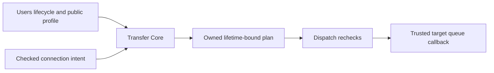

# Transfer Core — alpha-0.6.1

**Current increment — alpha-0.6.4:** [Connection Routing](CONNECTION_ROUTING.md) consolidates D/E CTM and RCM admission and delivery into one SID router, one immutable packet type and one bounded queue path. Recipients are fixed ready-session lifetimes: D targets only, E targets then independently echoes to the source. Tokens never select recipients; existing roles, wire validation, errors and privacy remain. Mixed-pair tests use the same token without crossing audiences.

**Increment delivered in alpha-0.6.3:** [ADC RCM](ADC_RCM.md) adds owning D/E reverse-request validation and live target/echo routing through Transfer Core, with per-family passive-source/active-target checks, stable lifetime/address admission and shared bounded queues. CTM/RCM share wire-field validation. Real ncdc covers RCM→CTM and peer handshakes in both roles; no pending-token registry or file-data handling is claimed.

**Increment delivered in alpha-0.6.2:** [ADC CTM](ADC_CTM.md) adds owning D/E CTM validation and live target/echo routing over Transfer Core, with checked source TCP activity, lifetime/endpoint rechecks, shared bounded queues and real ncdc client-handshake interoperability. Protocol/port/token/extensions retain their checked spelling and privacy. RCM and file-data handling remain later stages.

**alpha-0.6.1 local validation (2026-11-13):** All **124/124 CTest suites** passed in Debug, Release and ASan/UBSan with required integration tools and default leak detection, including native Transfer Core faults/lifetimes, live ADC/ADCS boundaries, real ncdc file-list refusal/chat recovery, existing Search/UDP interoperability, MariaDB and Apache HTTPS. The final attempt-retention/moved-plan regression also passed again in Debug and Release. No compiler warnings. WebAdmin production build/typecheck, **12 Node tests**, **10 Chromium tests** and real C++ API integration passed. Metadata, UTF-8, language parity/local links, changed Python syntax, example INI and whitespace checks passed. Remote CI, the full OS/client matrix and production load remain unverified.

Based directly on main `9e6d320bfebd4d95ec7da5d896f9ad71f8e33c16`, after alpha-0.5.13 was merged. The feature branch preserves previous code/history and is published separately; main is unchanged.

## Implemented scope

`dc24h_transfers` is a C++20 coordination library with owning checked requests and session-bound, one-attempt plans. It depends on Users and the shared text validator; it has no Search, ADC codec, socket, TLS, database or logger dependency. The server Core links the library as an architectural component. Running LoginHub does not yet invoke it for transfer commands. This stage implements the reusable engine, not live CTM/RCM handlers or file transfer.

The [ADC CTM/RCM specification](https://adc.sourceforge.io/ADC.html) separates connection offers from reverse requests. An active client supplies a connection port; a passive requester asks an active peer to initiate negotiation. A response preserves protocol/token. Client-to-client data exchange is separate from hub coordination. [ADCS](https://adc.sourceforge.io/ADC-EXT.html) also distinguishes hub encryption from client-to-client encryption.

The callback is an architectural boundary for a future ADC adapter. It neither opens a connection nor sends file bytes in this increment. The hub remains outside the client file-data path.

## Public types and validation

`transfers/request.hpp` defines RequestData, Kind, RequestError and immutable Request. Supported intent kinds are `connect_to_me` and `reverse_connect`, with an explicit IPv4/IPv6 family. A connect offer requires a signed input port in 1..65535; a reverse request must omit the port. Invalid native enums, negative/overflow/zero ports and contradictory reverse ports are rejected before owning copies.

Protocol and token are required, owning, already-NFC UTF-8 strings, bounded to **32** and **128 bytes** respectively. Controls, formatting and line/paragraph separators, invalid UTF-8 and decomposed text are rejected without silent normalization. Limits are checked before normalization/copying. Valid spaces/backslashes and unknown protocol names are preserved as opaque decoded data for a later codec. Bounds are local policy, not protocol-wide maxima. Allocation failure propagates without changing sessions.

A protocol string such as `ADCS/1.0` does not authorize encryption or establish support; Core does not negotiate protocol versions/features. A token is neither a credential nor a registered connection identity. There is no transfer-token correlation registry, duplicate-token policy, pending deadline or automatic timer in this foundation. Independently prepared intents may reuse opaque tokens. Future adapters must enforce protocol/security policy and wire limits before using Core.

## Plan and lifecycle contract

Core borrows a const SessionManager on its single owner thread. SessionManager must outlive Core and dispatch calls. Preparation validates a ready source lifetime and exact public source key, resolves a ready target key, rejects self-connections, validates request fields and checks current listener connectivity. It does not copy entire user profiles or mutate sessions.

| Intent | Listener | Connector | Connectivity rule |
| --- | --- | --- | --- |
| connect_to_me | Sender | Target | Sender has exact TCP4/TCP6 plus a usable public address in the requested family. Target may be active or passive. |
| reverse_connect | Target | Sender | Sender is passive in that family; target has exact TCP4/TCP6 and a usable public address. No port is invented before a later offer. |

This foundation uses the explicit family; it does not guess another family, switch direction, perform reachability checks or infer outgoing family support from TCP-active declarations. UDP activity/ports do not make a peer TCP-active. Passive/passive reverse coordination fails explicitly. Client hub transport ADC/ADCS is independent of the opaque requested peer protocol.

An owning Plan captures both local lifetime IDs, public source/target keys, the checked Request and fixed-size listener address bytes. Copies share one attempt and its observable State. A retained engine-domain token prevents foreign dispatch even if a destroyed Core's memory address is reused. Plans do not extend session/Core lifetimes; their own fields remain readable after cleanup. Moved-from plans are canceled/foreign and cannot dispatch.

| State | Meaning |
| --- | --- |
| prepared | Ready for one dispatch attempt or explicit cancel. |
| dispatching | Rechecks passed; the trusted sink is executing. |
| queued | Sink accepted target coordination into its queue, not proof of connection, handshake or transfer. |
| refused | Sink refused the target queue insertion. |
| canceled | Explicit cancellation or a source/target/connectivity recheck failed. |
| failed | Sink threw; the exception propagates and retry remains forbidden. |

`dispatch(plan, sink)` checks engine ownership and a nonempty sink first; these errors do not consume a prepared plan. It then consumes the shared attempt before rechecking both ready lifetimes/keys and listener connectivity/address. Disconnect, closing, SID reuse, active/passive changes and listener-address replacement cannot retarget an old plan. Unrelated nickname/profile/UDP changes need not cancel it. No bystander, broadcast or echo sink call exists: exactly the target lifetime receives at most one callback.

`cancel(plan)` succeeds only for an owned prepared plan. Copies observe the same canceled state. It does not retract queued actions or close peer connections. Reentrant dispatch/cancel of an already dispatching plan cannot duplicate it. Trusted sinks may close/remove either session: dispatch does not use borrowed session pointers after the callback. Sink exceptions set failed and propagate after possible partial external work, so callers must not blindly retry. Dispatch, cancel and current connectivity lookup allocate nothing after sink construction; preparation can allocate.

## Shared public connectivity

`users/connectivity.hpp` now owns AddressFamily, fixed-size AddressBytes, public_address and tcp_active. It extracts the existing Search numeric-address policy without weakening it: reject unspecified, multicast, limited IPv4 broadcast, mapped IPv6 and unsupported IPv6 link-local/zone destinations. Loopback/private addresses remain valid declarations for trusted local use. The ADC adapter remains responsible for kernel-peer address ownership; a standalone trusted Profile is not an authentication check. No DNS or probe occurs.

Search keeps its ReplyPaths/UdpEndpoint interface and an AddressFamily alias, using the same Users address extraction. Existing TCP/UDP independence and all UDP routing semantics remain. Transfers does not depend on Search to classify TCP activity.

## Live boundary, verification and future work

Running ADC/ADCS CTM/RCM still receives fixed recoverable `125 Command not implemented` after existing readiness/source checks. No target, source echo or bystander receives the request. Pre-login and forged-source attempts retain fatal 244/240 handling. There is no payload in logs, API, WebAdmin, SQL or search/chat counters. The API/WebAdmin continue their previous functions with updated release metadata; no transfer page, settings, metric or migration is introduced. CLI help explicitly distinguishes the implemented Transfer Core from pending live routing.

`transfers.core` covers request text/port/native boundaries, active/passive IPv4/IPv6 roles, source/target readiness, owned copies, cancellation, replay/reentrancy, queue refusal/throwing sinks, disconnect/SID reuse, dynamic INF metadata, unsafe address policy shared with Search, allocation failures and Core address reuse. `transfers.core.process` checks real ADC/ADCS refusal/recovery, privacy and bystander/source/state boundaries. Real `adc.transfercore.ncdc` / `adcs.transfercore.ncdc` ask for a peer file list, observe the explicit pending-handler diagnostic and prove chat still works. These are boundary/interoperability checks, not successful file-download tests.

Later increments must add typed CTM/RCM wire validation and target routing, protocol/TLS negotiation, bounded pending token lifecycle/timeouts, trusted policy/quotas and any monitoring. NAT traversal, SUDP, client transfer slots/content validation and actual file data handling are not implemented here. Local validation results are in [CHANGELOG](../../CHANGELOG.md). Remote CI, full OS/client coverage and production load need separate verification.
