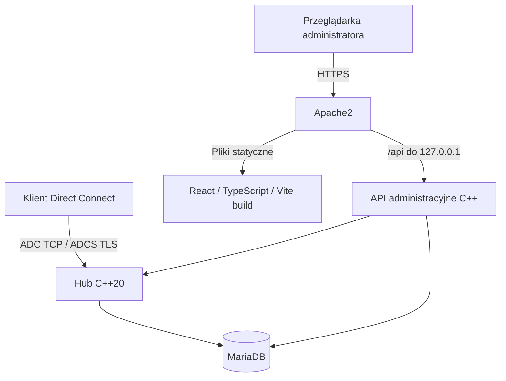

# dc24h.eu — plan rozwoju serwera ADC/ADCS Hub, Alpha 0.1

**Status:** plan do realizacji · **Data:** 2026-11-21 · **Wersja docelowa:** `v0.1.0-alpha.1`

## 1. Punkt wyjścia i cel

- Repozytorium `adrianf87/dc24h.eu` zawiera obecnie tylko plik `LICENSE` (GNU GPLv3). Kod, testy i dokumentacja muszą powstać od podstaw.
- Celem Alpha 0.1 jest **uruchamialny, testowalny hub Direct Connect obsługujący ADC oraz szyfrowany ADCS**, z podstawowym czatem, listą klientów i sygnalizacją wymiany plików peer-to-peer.
- Implementacja: **C++20**, **CMake**, asynchroniczne I/O, **OpenSSL 3**, **MariaDB**, **Apache HTTP Server 2.4**, **systemd** oraz **Webadmin: React + TypeScript + Vite**.
- Systemy docelowe: **Ubuntu Server 22.04 LTS, 24.04 LTS oraz 26.04 LTS**, architektura `amd64`; `arm64` jako rozszerzenie po Alpha.
- Priorytet: poprawność protokołu, bezpieczeństwo, interoperacyjność i automatyczne testy. Alpha nie oznacza gotowości produkcyjnej.

## 2. Zakres Alpha 0.1

### Wymagane (MVP)

1. Serwer TCP z obsługą wielu klientów i ograniczeniami zasobów; nasłuch ADC i ADCS na oddzielnych, konfigurowalnych portach (przykładowo `1510/tcp` oraz `1511/tcp`).
2. ADCS: TLS od początku połączenia TCP, certyfikat serwera, poprawne zamknięcie sesji, współpraca ze zgodnymi klientami; domyślnie zalecany jest **ADCS**, a nieszyfrowany ADC można wyłączyć.
3. Parser ADC: ramkowanie liniowe, UTF-8/NFC, escaping, typy komunikatów, walidacja SID/CID, błędów i limitów; sekwencja stanów `PROTOCOL → IDENTIFY → (VERIFY) → NORMAL`.
4. Minimum komunikatów: `SUP`, `SID`, `INF`, `STA`, `QUI`, `MSG`, a dla pracy P2P `SCH`, `RES`, `CTM`, `RCM`. Obsługa kierowania wiadomości zgodnie z typami ADC i rzeczywistymi uprawnieniami klienta.
5. Lista użytkowników, unikalne nicki w ramach sesji, nadawanie/zwalnianie SID, statusy dołączania i rozłączania, czat główny oraz prywatny w granicach obsługiwanego wariantu protokołu.
6. Przekazywanie żądań wyszukiwania i zestawiania połączeń między klientami. **Hub nie pośredniczy w transmisji plików** — transfer odbywa się bezpośrednio między klientami.
7. MariaDB: migracje SQL, konfiguracja huba, lista blokad, podstawowe zdarzenia administracyjne/audytowe. Baza nie może blokować pętli sieciowej.
8. Apache2: osobna witryna HTTPS z gotową aplikacją React (pliki statyczne z `webadmin/dist`) i proxy ścieżki `/api/` do administracyjnego HTTP API w C++ nasłuchującego wyłącznie na `127.0.0.1`.
9. Logowanie strukturalne, limity liczby połączeń, rozmiaru komend, szybkości komunikatów/wyszukiwań, timeouty handshake i bezpieczne wyłączenie procesu.
10. **Webadmin React + TypeScript + Vite:** ekran logowania, dashboard (stan huba, liczba użytkowników, uptime), tabela podłączonych klientów, lista banów z możliwością dodania/usunięcia blokady, odczyt zdarzeń administracyjnych, komunikaty błędów i potwierdzenia operacji. Układ responsywny.
11. Bezpieczny backend dla Webadmin: API `/api/v1/`, konta administratorów w MariaDB z hasłami haszowanymi Argon2id, sesje z cookie `HttpOnly`, `Secure`, `SameSite`, ochrona CSRF, role (`admin`, `viewer`), audyt zmian i ograniczanie prób logowania. Panel nie może łączyć się bezpośrednio z MariaDB.
12. Pakiety konfiguracyjne, systemd, instrukcja instalacji/aktualizacji oraz testy automatyczne backendu i Webadmin na trzech wersjach Ubuntu.

### Poza zakresem Alpha 0.1

- Publiczna produkcja, federacja wielu hubów, klaster HA, rozbudowana moderacja, pluginy, boty, pełny panel CMS, statystyki transferu, UDP search, interfejs wielu języków.
- Przechowywanie lub proxy plików użytkowników na serwerze.
- Pełne konta z hasłami **klientów ADC**, dopóki nie powstanie poprawny i zweryfikowany model bezpieczeństwa `GPA/PAS` (patrz ryzyka). Tryb podstawowy Alpha: goście ADC + osobne konta administratorów Webadmin.
- Zaawansowany CMS, pluginy panelu, rozbudowane wykresy historyczne i edytowanie wszystkich ustawień huba w czasie rzeczywistym.
- Oficjalny SLA, gwarancje stabilności, skala tysięcy połączeń, wydanie produkcyjne.

## 3. Architektura



- **Hub C++:** `asio`/Boost.Asio do asynchronicznych socketów i timerów, OpenSSL do TLS, oddzielne moduły parsera, maszyny stanów, użytkowników, routingu, repozytoriów danych oraz API; bez synchronicznych zapytań DB w wątkach I/O.
- **Apache2:** terminacja HTTPS **tylko panelu i API HTTP**; serwowanie skompilowanego SPA i reverse proxy `/api/` do C++ na loopback, z fallbackiem trasy SPA do `index.html`. **Nie jest zamiennikiem serwera ADCS**; strumień ADC/ADCS trafia bezpośrednio do komponentu C++.
- **Webadmin:** React + TypeScript + Vite w katalogu `webadmin/`; routowanie ekranów, formularze z walidacją, obsługa autoryzacji i błędów HTTP. W środowisku developerskim Vite proxy do `/api`; produkcyjnie `npm run build`, a Apache2 podaje wynik `dist`. Vite nie jest serwerem produkcyjnym.
- **API:** wersjonowane JSON REST `/api/v1`; minimalne endpointy: `POST /auth/login`, `POST /auth/logout`, `GET /auth/me`, `GET /status`, `GET /users`, `GET /bans`, `POST /bans`, `DELETE /bans/{id}`, `GET /audit`. Endpointy mutujące wymagają roli `admin`, tokenu CSRF oraz wpisu audytowego.
- **MariaDB:** oddzielny użytkownik SQL o minimalnych prawach, przygotowane zapytania, migracje wersjonowane. Wstępne tabele: `schema_migrations`, `hub_settings`, `bans`, `audit_events`, `admin_users`, `admin_sessions`; sesje muszą mieć czas wygaśnięcia i możliwość unieważnienia.
- **Konfiguracja:** `/etc/dc24h/hub.toml` lub YAML (wybrać jeden format w E0), certyfikaty tylko do odczytu przez usługę, sekrety z plików z ograniczonymi prawami lub systemd credentials, nie w repo.
- **Systemd:** `dc24h-hub.service`, dedykowane konto systemowe, restart kontrolowany, ograniczenia uprawnień i zasobów, dziennik przez journald.

### Proponowana struktura repozytorium

```text
.
├── CMakeLists.txt
├── CMakePresets.json
├── README.md
├── LICENSE
├── cmake/
├── include/dc24h/
├── src/{main,net,adc,hub,storage,admin}/
├── migrations/
├── tests/{unit,integration,interop}/
├── config/hub.example.toml
├── packaging/{systemd,apache2}/
├── docs/{architecture,protocol,operations}/
├── webadmin/{src,public,tests}/
├── webadmin/package.json
├── webadmin/tsconfig.json
├── webadmin/vite.config.ts
└── .github/workflows/
```

## 4. Etapy realizacji (propozycja: 12–14 tygodni, 1 programista)

| Etap | Czas orientacyjny | Zakres | Warunek zamknięcia |
|---|---:|---|---|
| **E0 — Fundament projektu** | Tydzień 1 | CMake/C++20, formatowanie, repo, bazowe testy, CI; szkielet React/TS/Vite | Build + test backendu i build Webadmin uruchamiają się automatycznie |
| **E1 — Parser i protokół** | Tygodnie 2–3 | Komendy, typy, kodowanie, handshake, stany ADC | Testy poprawnych i błędnych ramek oraz zgodności ze specyfikacją |
| **E2 — TCP, TLS i sesje** | Tygodnie 3–4 | Asynchroniczny serwer, ADCS, certyfikaty, timeouty, SID | 2 klientów łączy się po ADCS, przechodzi handshake i rozłącza bez błędów |
| **E3 — Obecność i komunikacja** | Tygodnie 5–6 | INF/QUI, nicki, lista, MSG, prywatne wiadomości | 10 klientów wymienia wiadomości, poprawne broadcast/route |
| **E4 — P2P i wyszukiwanie** | Tygodnie 6–7 | SCH/RES/CTM/RCM, filtrowanie i routing | W realnych klientach działa wyszukanie i inicjowanie transferu P2P |
| **E5 — MariaDB** | Tydzień 8 | Schemat, migracje, blokady, ustawienia, audyt | Testy migracji, trwałość blokad i restart bez utraty konfiguracji |
| **E6a — API i uwierzytelnianie Webadmin** | Tygodnie 9–10 | REST/JSON, role, sesje, hasła Argon2id, CSRF, audyt | Zalogowany admin zarządza banami, viewer ma tylko odczyt, API jest lokalne |
| **E6b — Frontend React/TS/Vite i Apache2** | Tygodnie 10–11 | Logowanie, dashboard, online users, bans, audit, HTTPS i SPA | Panel działa przez Apache2; frontend nie zna sekretów SQL i nie wymaga uruchomionego Vite |
| **E7 — Testy, bezpieczeństwo, wydanie** | Tygodnie 12–14 | Interoperacyjność, testy UI/E2E, obciążenie, pakiet systemd, instrukcje, release | Spełnione kryteria akceptacji i opublikowany tag `v0.1.0-alpha.1` |

Zależności: `E0 → E1 → E2 → E3 → E4`; `E5` może biec równolegle z końcówką `E3/E4`; `E6a` wymaga `E2` oraz `E5`; `E6b` zależy od kontraktu API z `E6a` i może częściowo powstawać równolegle na mockach; `E7` integruje całość. Czasy są szacunkiem i należy je zweryfikować po E1.

## 5. Backlog GitHub Issues / GitHub Project #2

Każdy punkt powinien być osobnym Issue, z etykietą etapu i kryteriami akceptacji. W widoku projektu stosować statusy **Todo → In Progress → Done**, dodać pole **Priority** (`P0/P1/P2`) oraz, jeśli dostępne, **Iteration**.

1. **E0 / P0 — Repozytorium, CMake, CI i standard jakości**: projekt kompiluje się, format/lint/test w CI, macierz Ubuntu.
2. **E1 / P0 — Parser ADC i maszyna stanów**: walidacja komend, wyjście błędu STA, fuzz test, handshake.
3. **E2 / P0 — Serwer TCP i ADCS/TLS**: sesje, TLS, SID, limit zasobów, bezpieczny shutdown.
4. **E3 / P0 — Lista klientów i routing czatu**: INF, QUI, MSG, unikalne nicki, testy wielu klientów.
5. **E4 / P0 — Wyszukiwanie i sygnalizacja P2P**: SCH, RES, CTM, RCM, zgodność aktywny/pasywny.
6. **E5 / P1 — Integracja MariaDB**: migracje, settings, bans, audit, brak blokowania I/O.
7. **E6a / P0 — API administracyjne C++ i bezpieczne sesje**: JSON REST, `admin_users`, Argon2id, role, cookies, CSRF, audyt, ban/unban.
8. **E6b / P0 — Webadmin React + TypeScript + Vite**: logowanie, dashboard, lista klientów, bany, audyt, walidacja formularzy, responsywny UI.
9. **E6b / P1 — Apache2, HTTPS i publikacja SPA**: `webadmin/dist`, reverse proxy `/api/`, fallback SPA, nagłówki bezpieczeństwa, brak publicznego portu API.
10. **E7 / P0 — Testy interoperacyjności, obciążenia i bezpieczeństwa**: scenariusze realnych klientów, testy API/UI i raport pomiarów.
11. **E7 / P1 — Pakowanie, systemd i wydanie Alpha**: konfiguracja, instalacja, aktualizacja, rollback, tag release.
12. **Analiza / P1 — Bezpieczne logowanie użytkowników ADC**: decyzja architektoniczna dla `GPA/PAS`, bez implementacji dopóki nie będzie bezpiecznego modelu sekretów.

## 6. Kryteria akceptacji wydania

- **Funkcjonalność:** co najmniej dwa niezależne klienty zgodne z ADC/ADCS pomyślnie łączą się, widzą listę, wysyłają chat/PM, wykonują wyszukiwanie i inicjują połączenie P2P; odłączanie i ponowne łączenie działają.
- **Kompatybilność:** udokumentowane uruchomienie i smoke testy na Ubuntu Server 22.04, 24.04, 26.04 LTS; kompilacja na jednej obsługiwanej wersji GCC/Clang dostępnej na każdej dystrybucji.
- **Zabezpieczenia:** skonfigurowany TLS z walidowaną polityką certyfikatów, brak wycieków sekretów, limity, timeouty, bez nieograniczonych kolejek; nieszyfrowane ADC możliwe do wyłączenia.
- **Testy:** testy jednostkowe parsera/stanu, testy integracyjne (TCP, TLS, MariaDB, Apache), przypadki odmowy usługi na poziomie pojedynczej sesji i automatyczny pipeline CI.
- **Webadmin:** konto `admin` loguje się i wylogowuje przez HTTPS; dashboard pokazuje stan huba i użytkowników; lista banów pozwala dodawać/usuwać wpisy; rola `viewer` nie może modyfikować danych; testy frontendowe (Vitest/React Testing Library) oraz minimum jeden scenariusz E2E w przeglądarce (Playwright).
- **API / dostęp:** nieautoryzowane żądania kończą się 401/403, sesje wygasają i można je unieważnić, mutacje są chronione przed CSRF, hasła administracji są haszowane Argon2id i logi nie ujawniają haseł ani tokenów.
- **Stabilność (laboratoryjna):** test co najmniej 100 jednoczesnych sesji i 6-godzinny test ciągły bez crasha; wyniki zużycia CPU/RAM oraz liczby błędów dołączyć do release notes. To cel testowy, **nie deklaracja wydajności produkcyjnej**.
- **Operacyjność:** usługa systemd start/stop/restart, migracje i backup SQL opisane, przykładowa konfiguracja bez sekretów, health/status dostępne tylko w dozwolonym zakresie.
- **Formalnie:** wszystkie Issues P0 zamknięte; przegląd kodu zakończony, brak znanych krytycznych błędów bezpieczeństwa, changelog i tag `v0.1.0-alpha.1`.

## 7. Główne ryzyka i decyzje przed implementacją

| Ryzyko / decyzja | Działanie |
|---|---|
| **Kompatybilność ADC** | Trzymać się [ADC 1.0.4](https://adc.sourceforge.io/ADC.html) i [ADC Extensions 1.0.9](https://adc.sourceforge.io/ADC-EXT.html); testować na realnych klientach, a nie tylko emulatorze. |
| **ADCS i Apache2** | ADCS jest TLS opakowującym surowy TCP ADC; Apache2 obsługuje osobne HTTPS panelu, nie port klientów ADC. |
| **Bezpieczeństwo Webadmin** | Nie umieszczać sekretów w kodzie React ani zmiennych `VITE_*`; wymagać HTTPS, cookies `HttpOnly`/`Secure`, CSRF dla mutacji, CSP i rate limit logowania. API nasłuchuje tylko na loopback. |
| **Hasła ADC (`GPA/PAS`)** | Standardowa odpowiedź PAS zależy od hasła i losowego wyzwania; zwykły hash Argon2id hasła w bazie nie wystarczy do weryfikacji odpowiedzi. Opracować osobny, bezpieczny model i analizę zagrożeń przed włączeniem kont; nie przechowywać haseł jawnych w MariaDB. |
| **Wersje zależności** | Budować/testować na każdej wspieranej wersji Ubuntu, nie polegać wyłącznie na `ubuntu-latest`; przypiąć wersje zależności i śledzić poprawki bezpieczeństwa. |
| **Nadużycia i zgłaszanie błędów** | Rate limiting, wielkość ramek, timeouty i limity pamięci wdrożyć od pierwszych etapów. |

## 8. Organizacja pracy GitHub

- Gałąź `main` jest stabilnym punktem integracji. Zmiany przez krótkie branche `feature/eX-nazwa`, Pull Requests i wymagane kontrole CI; przed wydaniem włączyć ochronę `main`, gdy zostaną uzgodnione zasady pracy.
- Jeden Issue = jedno weryfikowalne zadanie; opisy zawierają **zakres, kryteria akceptacji, testy i zależności**. Drobne implementacje prowadzić jako checklisty/sub-issues.
- GitHub Project [dc24h.eu #2](https://github.com/users/adrianf87/projects/2): kolejność `E0...E7`, widoki „Backlog” i „Alpha 0.1”, podział na P0/P1/P2, aktualizacja statusu po PR.
- Tag roboczy tylko po przejściu testów; Alpha wydać jako prerelease, bez deklarowania gotowości produkcyjnej.

## 9. Pierwszy sprint — rekomendowana kolejność

1. Zaakceptować zakres MVP, format konfiguracji (`TOML` proponowany), stos asynchronicznego I/O (Boost.Asio proponowany), nazwy usług i porty.
2. Dodać `CMakeLists.txt`, katalog `src/`, testy GoogleTest/Catch2, `webadmin/` z szablonem Vite `react-ts`, lockfile `package-lock.json` i GitHub Actions: testy C++ na Ubuntu 22.04/24.04/26.04 (kontenery/VM, jeśli runner niedostępny) oraz `npm ci`, `tsc --noEmit`, testy UI i `vite build` na wspieranym Node.js LTS.
3. Dodać parser komend ADC z testami danych poprawnych i złośliwych. Dopiero potem budować pełny socket server.
4. Przygotować pierwszy klient testowy/interoperacyjny i przykładową konfigurację TLS.

**Źródła techniczne:** [ADC Specification](https://adc.sourceforge.io/ADC.html), [ADC Extensions / ADCS](https://adc.sourceforge.io/ADC-EXT.html), [Apache reverse proxy](https://httpd.apache.org/docs/2.4/howto/reverse_proxy.html), [Vite / React + TypeScript](https://vite.dev/guide/), [Vite production build](https://vite.dev/guide/build.html), [Ubuntu Release Notes](https://documentation.ubuntu.com/release-notes/).
