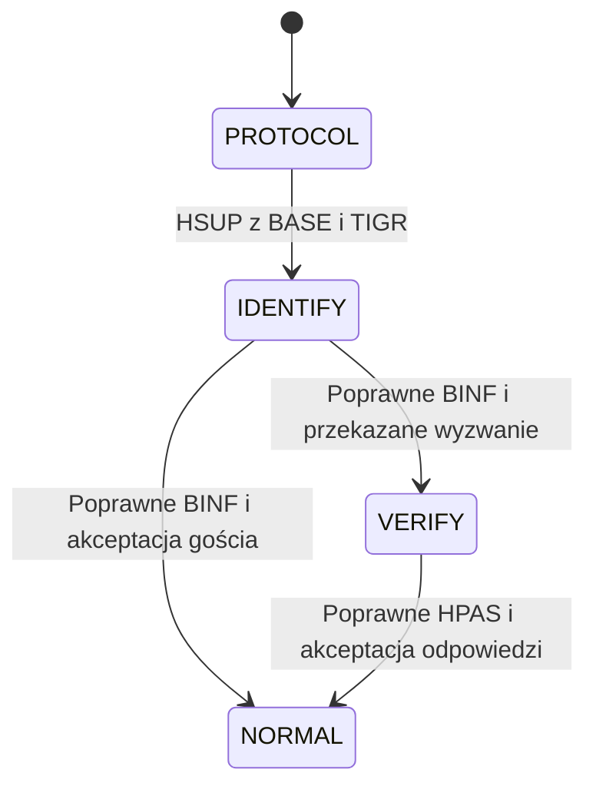

# Parser ADC i maszyna stanów połączenia

[English (en-US)](../../us/alpha-0.1/ADC-PARSER.md)

Cel CMake `dc24h_adc` udostępnia parser liniowy i sekwencję nawiązywania połączenia po stronie huba. Publiczne nagłówki są w `include/dc24h/adc/`. Implementacja korzysta z gramatyki ramek ADC, reguł przejść klient–hub i formatu skrótu TIGR. [ADC 1.0.4](https://adc.sourceforge.io/ADC.html), [ADC Extensions 1.0.9](https://adc.sourceforge.io/ADC-EXT.html)

## Ramki i walidacja

`parse_frame` przyjmuje dokładnie jedną ramkę zakończoną LF. `FrameDecoder::consume` przetwarza najwyżej jedną linię lub jej fragment i podaje liczbę zużytych bajtów. Pozostałe bajty przekaż ponownie do `consume`. Wynik może zawierać samodzielny obiekt `Message`, `KeepAlive` dla samego LF albo `ParseError`. Wywołanie `finish()` po zakończeniu strumienia wykrywa urwaną linię i resetuje dekoder.

Domyślne limity to 16 384 bajty przed LF, 128 parametrów oraz 4096 bajtów w zapisie protokołu na parametr. Pole selektorów w nagłówku `F` mieści do 128 selektorów i 4096 bajtów. Progi można dostosować przez `Limits`. Przekroczenie długości linii zgłasza jeden błąd, a dekoder pomija jej resztę aż do najbliższego LF.

Parser rozpoznaje nagłówki `B`, `C`, `D`, `E`, `F`, `H`, `I` i `U` oraz zachowuje poprawne składniowo nazwy komend. Sprawdza SID w nagłówkach routingu, CID w Base32 w nagłówku UDP i selektory rozszerzeń. Dekoduje `\s`, `\n` i `\\` przed sprawdzeniem UTF-8 i NFC za pomocą utf8proc. Wadliwe UTF-8, tekst spoza NFC oraz nieznane sekwencje ucieczki zwracają błąd. `escape_parameter` koduje separatory w uprzednio zwalidowanym tekście.

`protocol.hpp` udostępnia walidatory komend `SUP`, `SID`, `INF`, `STA`, `QUI`, `GPA` i `PAS`. Zwracane widoki tekstu są ważne, dopóki źródłowy `Message` istnieje i pozostaje niezmieniony. CID i PID w TIGR kodują po 24 bajty w 39 znakach Base32 z zerowymi niewykorzystanymi bitami. Libgcrypt oblicza skrót Tiger z odkodowanego PID, a wynik musi zgadzać się z CID.

## Sesja po stronie huba



Utwórz `Session`, podając nadany wcześniej SID. Poprawne `HSUP` w `PROTOCOL` zwraca kolejno `ISUP` i `ISID`. Sesja stosuje zmiany rozszerzeń atomowo w `NORMAL` i przechowuje do 64 ogłoszonych nazw. Wymaga `BASE` i wybiera TIGR raz podczas logowania. Nieznane nazwy mogą być zapisane jako deklaracje klienta.

W `IDENTIFY` komenda `BINF` z nadanym SID i poprawną parą `ID`/`PD` zwraca `SessionAction::identified`. Sesja zapamiętuje CID. Wywołaj `complete_identification()`, aby przyjąć gościa, albo przekaż wyzwanie z co najmniej 24 losowymi bajtami zapisanymi w Base32, aby wysłać `IGPA` i przejść do `VERIFY`. Zachowaj wyzwanie dla weryfikatora. Poprawne składniowo `HPAS` zwraca `SessionAction::verify_password`. Kod wywołujący sprawdza odpowiedź i przekazuje wynik do `complete_verification`.

Sesja zwraca `ISTA` przy błędnych komendach, naruszeniu kolejności i nieudanej negocjacji. Przyjmuje `HSTA` w każdym stanie, a status krytyczny zamyka sesję. Po przypisaniu SID `disconnect()` zwraca `IQUI`. Przekaż odpowiedzi w kolejności przed obsłużeniem `SessionAction::close`. W `NORMAL` akcja `dispatch` przekazuje komendę ze zgodnym SID nadawcy do dalszej walidacji i routingu. Sesja odrzuca aktualizacje `INF` z `PD` oraz zmiany CID.

Do kodu wywołującego należą transport, nadawanie SID, timeouty, limity szybkości, lista klientów i weryfikacja danych uwierzytelniających. Przed przekazaniem informacji o kliencie usuń `PD` z pierwszego `BINF` i sprawdź ogłoszone adresy klienta względem adresu połączenia.

## Testy i fuzzing

Standardowe presety CTest wykonują testy parsera, walidacji komend i sesji. Opcjonalny fuzzing lokalny wymaga Clanga z libFuzzer, AddressSanitizerem i UndefinedBehaviorSanitizerem.

```sh
cmake -S . -B build/fuzz -DCMAKE_CXX_COMPILER=clang++ \
  -DCMAKE_BUILD_TYPE=RelWithDebInfo -DBUILD_TESTING=OFF -DDC24H_ENABLE_FUZZING=ON
cmake --build build/fuzz --target dc24h_adc_fuzz
mkdir -p build/fuzz/corpus
printf '%s\n' 'HSUP ADBASE ADTIGR' 'BINF ABCD IDW6AIUW3CLDF6OGHNVE4JPDDJ2P74IWRCF2O36TA PDAAAQEAYEAUDAOCAJBIFQYDIOB4IBCEQTCQKRMFY' 'HSUP ADTCP4' > build/fuzz/corpus/login
printf '%s\n' 'FMSG ABCD +TCP4-UDP6 hello\sworld' 'ISID ABCD' 'HSTA 000 OK' 'IQUI ABCD' > build/fuzz/corpus/frames
./build/fuzz/dc24h_adc_fuzz build/fuzz/corpus -max_total_time=30 -max_len=32768
```
