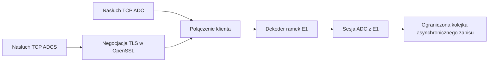

# Serwer TCP i ADCS

[English (en-US)](../../us/alpha-0.1/TCP-ADCS.md)

Etap E2 dodaje do `dc24h-hub` dwa nasłuchy TCP oparte na Boost.Asio. Pula wątków współdzieli jeden `io_context`. Strand serializuje obsługę nasłuchów, rejestru połączeń i przydzielania SID. Każdy przyjęty socket ma własny strand, dekoder, stan protokołu, timer i kolejkę wyjściową.



Sesja E1 negocjuje `BASE` i `TIGR`, zwraca `ISUP` i `ISID` oraz sprawdza `BINF` klienta. Hub wysyła własne `IINF`, a ostatnią ramką logowania jest `BINF` dotyczące tego klienta. Odpowiedź pomija `PD` i w ogłoszonym polu adresu właściwej rodziny używa rzeczywistego adresu połączenia. Przydzielanie SID pomija zero i zwalnia identyfikator po zamknięciu socketu. [ADC 1.0.4](https://adc.sourceforge.io/ADC.html)

## Konfiguracja

Opcja `--serve` uruchamia nasłuchy. Etap E2 pobiera ustawienia z argumentów polecenia. Konfiguracja TOML jest przewidziana w planie projektu.

| Opcje | Wartość domyślna i działanie |
| --- | --- |
| `--tls-cert FILE`, `--tls-key FILE` | Wymagany łańcuch certyfikatów PEM oraz pasujący, niezaszyfrowany klucz prywatny PEM. |
| `--adcs-address IP`, `--adcs-port PORT` | ADCS na `127.0.0.1:1511`. |
| `--enable-adc`, `--adc-address IP`, `--adc-port PORT` | Jawnie włącza nieszyfrowany ADC, domyślnie na `127.0.0.1:1510`. |
| `--max-clients COUNT` | 128 połączeń łącznie dla obu nasłuchów, wliczając rozpoczęte handshaki. |
| `--input-bytes BYTES` | 16 384 bajty na ramkę ADC przed LF. Pojedynczy odczyt ma najwyżej 4096 bajtów. |
| `--pending-bytes BYTES` | 65 536 oczekujących bajtów na sesję, wliczając bieżący zapis. |
| `--setup-timeout-ms MS` | 30 000 ms od przyjęcia TCP do wejścia sesji ADC w `NORMAL`. |
| `--tls-timeout-ms MS` | 10 000 ms na handshake TLS w ramach ogólnego limitu ustanawiania połączenia. |
| `--identify-timeout-ms MS` | 15 000 ms od rozpoczęcia obsługi ramek ADC do `NORMAL`, w ramach limitu całego handshake. |
| `--idle-timeout-ms MS` | 300 000 ms bez poprawnej składniowo ramki lub keepalive w stanie `NORMAL`. |
| `--shutdown-timeout-ms MS` | 2000 ms na opróżnienie kolejki i zamknięcie każdej sesji. |
| `--threads COUNT` | Dwa wątki I/O. Zakres wynosi od 1 do 64. |

Podaj numeryczny adres IPv4 lub IPv6 oraz różne porty ADC i ADCS. Nasłuch IPv6 przyjmuje połączenia IPv6. Port `0` wybiera wolny port efemeryczny, który program wyświetla przy starcie. Limity buforów mieszczą się w zakresie od 1 do 1 048 576 bajtów, a timeouty od 1 ms do 24 godzin. Nadal obowiązują limity liczby i długości parametrów z E1.

## TLS i obsługa połączeń

Port ADCS rozpoczyna od negocjacji TLS i zamyka socket, jeśli handshake się nie powiedzie. OpenSSL przyjmuje TLS 1.2 i nowsze wersje. W TLS 1.2 dostępne są zestawy ECDHE z AES-GCM lub ChaCha20-Poly1305. Kompresja i renegocjacja TLS są wyłączone. Użyj zaufanego łańcucha dla nazwy, z którą łączą się klienci, i zapewnij kontu huba odczyt klucza. Serwer sprawdza parę przy uruchomieniu. Przechowuj certyfikat i klucz poza repozytorium. [ADC Extensions 1.0.9](https://adc.sourceforge.io/ADC-EXT.html)

Serwer odrzuca nowe połączenia po osiągnięciu limitu, pomija wadliwe ramki i zamyka sesje przekraczające limity wejścia lub wyjścia. Logi obejmują zdarzenia połączenia, handshake i rozłączania bez zapisywania treści ramek. Sygnały `SIGINT` i `SIGTERM` zatrzymują nasłuchiwanie i rozpoczynają zamykanie sesji. Ustanowione sesje opróżniają kolejkę, wysyłają `IQUI`, jeśli pozwala na to stan protokołu, i wymieniają komunikaty zamknięcia TLS na ADCS. Po upływie timeoutu pozostałe połączenia są zamykane. Wątki I/O kończą pracę po zakończeniu lub anulowaniu operacji.

## Uruchamianie i testowanie lokalne

Poniższe polecenia tworzą krótkotrwały certyfikat do testów loopback. Uruchom je z katalogu repozytorium po zbudowaniu presetu `debug`.

```sh
tls_dir=$(mktemp -d)
(
  umask 077
  openssl req -x509 -newkey ec -pkeyopt ec_paramgen_curve:prime256v1 -noenc \
    -days 1 -subj /CN=localhost -addext 'subjectAltName=DNS:localhost,IP:127.0.0.1' \
    -out "$tls_dir/server.pem" -keyout "$tls_dir/server-key.pem"
)
./build/debug/dc24h-hub --serve --adcs-port 0 \
  --tls-cert "$tls_dir/server.pem" --tls-key "$tls_dir/server-key.pem"
```

Polecenie `ctest --preset debug -R '^AdcServer\.'` uruchamia testy sieciowe. Korzystają z tymczasowych certyfikatów i efemerycznych portów loopback. Scenariusz ADCS obejmuje dwóch niezależnych klientów, oba etapy handshake i poprawne rozłączenie. `ctest --preset release` wykonuje cały zestaw dla Release.

E2 ustanawia połączenia gości. E3 rozszerza te same nasłuchy i sesje o wspólną listę użytkowników i czat. [Obecność użytkowników i czat](PRESENCE-CHAT.md)
