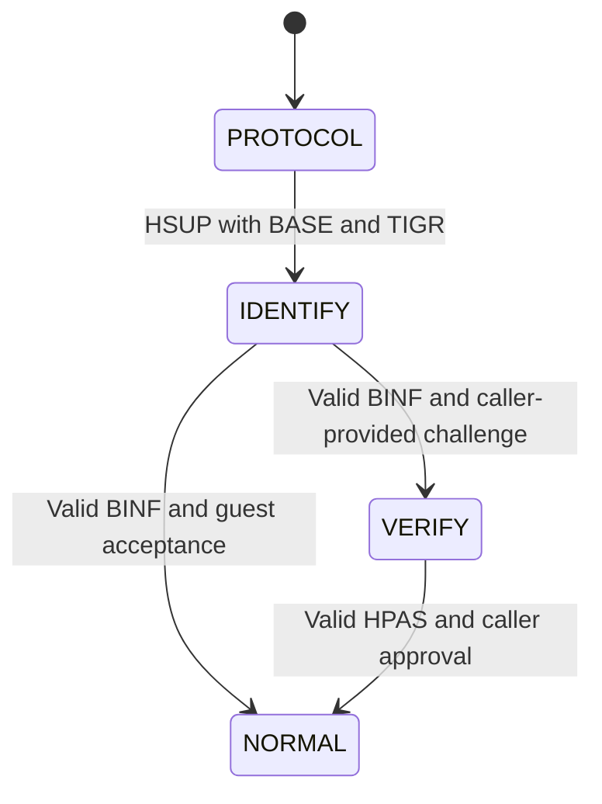

# ADC parser and connection state machine

[Polski (pl-PL)](../../pl/alpha-0.1/ADC-PARSER.md)

The CMake target `dc24h_adc` exposes the E1 line parser and hub-side handshake under `include/dc24h/adc/`. The implementation follows the ADC line grammar, client–hub state transitions, and the TIGR digest format. [ADC 1.0.4](https://adc.sourceforge.io/ADC.html), [ADC Extensions 1.0.9](https://adc.sourceforge.io/ADC-EXT.html)

## Framing and validation

`parse_frame` reads exactly one LF-terminated frame. `FrameDecoder::consume` processes at most one line or line fragment and reports how many bytes it consumed. Pass the remaining bytes back to `consume` until the chunk is exhausted. Each result can contain an owning `Message`, a `KeepAlive` for a bare LF, or a `ParseError`. Call `finish()` at end of stream to detect a partial line and reset the decoder.

The default limits are 16,384 bytes before LF, 128 parameters, and 4,096 wire bytes per parameter. Feature selectors in an `F` header share the selector count limit of 128 and the byte limit of 4,096. `Limits` allows callers to tune these thresholds. An oversized line yields one error, and the decoder drops its remainder through the next LF before resuming.

The parser recognizes `B`, `C`, `D`, `E`, `F`, `H`, `I`, and `U` headers and preserves syntactically valid command names. It checks routing SIDs, Base32-encoded UDP CIDs, and feature selectors. It decodes `\s`, `\n`, and `\\` before checking UTF-8 and NFC with utf8proc. Ill-formed UTF-8, non-NFC text, and unknown escapes yield parse errors. `escape_parameter` escapes delimiters in already-validated text.

`protocol.hpp` provides command-specific validators for `SUP`, `SID`, `INF`, `STA`, `QUI`, `GPA`, and `PAS`. The returned text views are valid while the original `Message` remains alive and unchanged. A TIGR CID or PID encodes 24 bytes in 39 uppercase Base32 characters with zero unused bits. Libgcrypt hashes the decoded PID with Tiger, and the result must match the CID.

## Hub-side session



Construct `Session` with a SID assigned by the caller. A valid `HSUP` in `PROTOCOL` yields `ISUP` followed by `ISID`. The session applies support changes atomically in `NORMAL` and retains up to 64 advertised features. It requires `BASE` and selects TIGR once at login. Unrecognized feature names can be recorded as peer advertisements.

In `IDENTIFY`, a `BINF` with the assigned SID and a valid `ID`/`PD` pair yields `SessionAction::identified`. The session retains the CID. Call `complete_identification()` to admit a guest or pass a Base32 challenge containing at least 24 random bytes to send `IGPA` and enter `VERIFY`. Keep the challenge for the verifier. A structurally valid `HPAS` yields `SessionAction::verify_password`. The caller checks the response and passes the result to `complete_verification`.

The session returns `ISTA` for invalid commands, state violations, and failed negotiation. It accepts `HSTA` in every state and closes on fatal status. `disconnect()` yields `IQUI` after SID assignment. Deliver replies in order before acting on `SessionAction::close`. In `NORMAL`, the `dispatch` action hands a message with a matching sender SID to the caller for further validation and routing. The session declines `INF` updates containing `PD` and updates that change the CID.

The caller owns transport I/O, SID allocation, timeout and rate limits, client record management, and the credential verifier. Strip `PD` from the initial `BINF` and check advertised client addresses against the peer address before distributing client information.

## Tests and fuzzing

The standard CTest presets run the parser, command validation, and session tests. Use Clang with libFuzzer, AddressSanitizer, and UndefinedBehaviorSanitizer for an opt-in local fuzzing run.

```sh
cmake -S . -B build/fuzz -DCMAKE_CXX_COMPILER=clang++ \
  -DCMAKE_BUILD_TYPE=RelWithDebInfo -DBUILD_TESTING=OFF -DDC24H_ENABLE_FUZZING=ON
cmake --build build/fuzz --target dc24h_adc_fuzz
mkdir -p build/fuzz/corpus
printf '%s\n' 'HSUP ADBASE ADTIGR' 'BINF ABCD IDW6AIUW3CLDF6OGHNVE4JPDDJ2P74IWRCF2O36TA PDAAAQEAYEAUDAOCAJBIFQYDIOB4IBCEQTCQKRMFY' 'HSUP ADTCP4' > build/fuzz/corpus/login
printf '%s\n' 'FMSG ABCD +TCP4-UDP6 hello\sworld' 'ISID ABCD' 'HSTA 000 OK' 'IQUI ABCD' > build/fuzz/corpus/frames
./build/fuzz/dc24h_adc_fuzz build/fuzz/corpus -max_total_time=30 -max_len=32768
```
