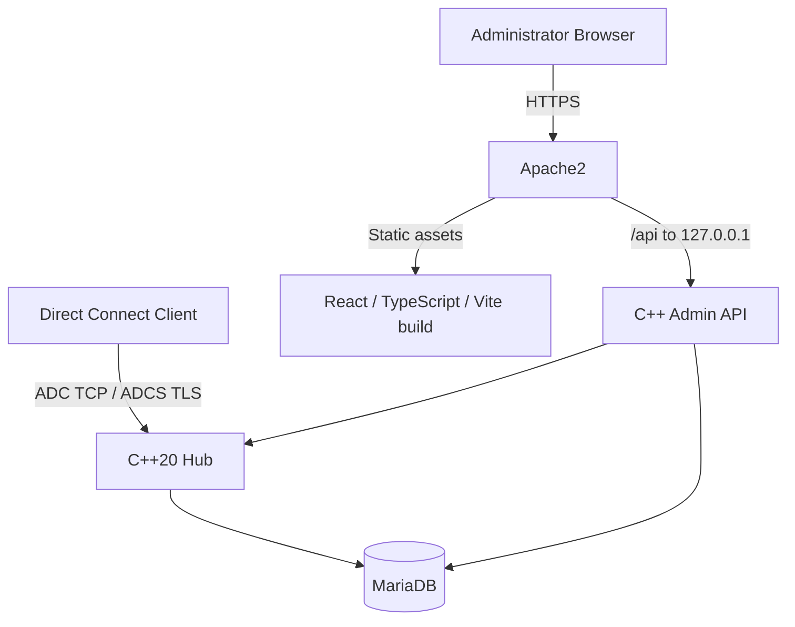

# dc24h.eu — ADC/ADCS Hub Development Plan, Alpha 0.1

**Language:** English (United States, en-US) · **Status:** planned · **Date:** 2026-11-21 · **Target release:** `v0.1.0-alpha.1`

[English (en-US)](../../us/alpha-0.1/ALPHA-0.1-PLAN.md) | [Polski (pl-PL)](../../pl/alpha-0.1/ALPHA-0.1-PLAN.md)

## 1. Starting Point and Goal

- The `main` branch of `adrianf87/dc24h.eu` currently contains the GNU GPLv3 `LICENSE`. The initial documentation is being developed in Pull Request #1; application code, tests, and installation instructions still need to be built from scratch.
- Alpha 0.1 aims to provide a **runnable, testable Direct Connect hub supporting both ADC and encrypted ADCS**, with basic chat, a client list, and peer-to-peer file-sharing signaling.
- Technology stack: **C++20**, **CMake**, asynchronous I/O, **OpenSSL 3**, **MariaDB**, **Apache HTTP Server 2.4**, **systemd**, and **Webadmin: React + TypeScript + Vite**.
- The `amd64` targets are **Ubuntu Server 22.04 LTS, 24.04 LTS, and 26.04 LTS**, **Debian 12 (Bookworm)**, and **Debian 13 (Trixie)**. Consider `arm64` after Alpha.
- Priorities: protocol correctness, security, interoperability, and automated tests. Alpha does **not** mean production-ready.

## 2. Alpha 0.1 Scope

### Required (MVP)

1. A multi-client TCP server with resource limits; ADC and ADCS listeners on separate, configurable ports (for example, `1510/tcp` and `1511/tcp`).
2. ADCS: TLS immediately after establishing TCP, a server certificate, proper session shutdown, and interoperability with compliant clients. **ADCS is recommended by default**; unencrypted ADC must be configurable as disabled.
3. ADC parser: line framing, UTF-8/NFC, escaping, message types, SID/CID validation, error handling, and limits. State sequence: `PROTOCOL → IDENTIFY → (VERIFY) → NORMAL`.
4. Minimum commands: `SUP`, `SID`, `INF`, `STA`, `QUI`, `MSG`; for P2P operations, `SCH`, `RES`, `CTM`, and `RCM`. Route messages according to ADC message types and each client's permissions.
5. Client list, nicknames unique within a session, SID allocation/release, join and disconnect notifications, public chat, and private messages within the supported protocol scope.
6. Forward search and connection-negotiation messages between clients. **The hub does not relay file contents**; file transfers happen directly between clients.
7. MariaDB: SQL migrations, hub settings, bans, and basic administrative/audit events. Database work must not block the network event loop.
8. Apache2: a dedicated HTTPS site serving the compiled React application (static assets from `webadmin/dist`), plus an `/api/` reverse proxy to the C++ administration HTTP API listening **only** on `127.0.0.1`.
9. Structured logging, limits on connections, command length, message/search rates, handshake timeouts, and graceful process shutdown.
10. **Webadmin React + TypeScript + Vite:** login screen, dashboard (hub state, online client count, uptime), connected-client table, ban list with add/remove operations, administrative event log, error feedback, and action confirmations. Responsive layout.
11. Secure Webadmin backend: versioned `/api/v1/` API, administrator accounts in MariaDB with Argon2id password hashes, sessions using `HttpOnly`, `Secure`, `SameSite` cookies, CSRF protection, `admin` and `viewer` roles, audit logging, and login rate limiting. The browser must never connect directly to MariaDB.
12. Configuration and service packaging, systemd integration, installation/upgrade instructions, and automated backend and Webadmin tests. GitHub Actions runs the tests on all three Ubuntu versions. Debian 12 and 13 are verified in separate test environments.

### Out of Scope for Alpha 0.1

- Public production operations, multi-hub federation, an HA cluster, extensive moderation, plugins, bots, a full CMS, transfer statistics, UDP search, and a multilingual application interface.
- Storing or proxying user files on the hub server.
- Full password-based **ADC client accounts** until a correct, security-reviewed `GPA/PAS` authentication design is available (see risks). Alpha's baseline is guest ADC users plus separate Webadmin administrator accounts.
- Advanced CMS features, Webadmin plugins, detailed historical charts, and live editing of every hub setting.
- An official SLA, stability guarantees, support for thousands of simultaneous clients, or a production release.

## 3. Architecture



- **C++ hub:** `asio`/Boost.Asio for asynchronous sockets and timers; OpenSSL for TLS; separate modules for parsing, state handling, clients, routing, data repositories, and the API. No synchronous DB queries in I/O threads.
- **Apache2:** HTTPS termination **for the administration site and HTTP API only**, hosting the compiled SPA and proxying `/api/` to the C++ loopback service. Route fallback to `index.html` for client-side navigation. Apache2 **does not replace the ADCS server**: ADC/ADCS connections go directly to the C++ component.
- **Webadmin:** React + TypeScript + Vite in `webadmin/`, with client-side routes, validated forms, authorization-aware pages, and API error handling. Use a Vite `/api` proxy during development; build with `npm run build` for deployment. Apache2 serves `dist`; Vite's development server is not used in production.
- **API:** versioned JSON REST under `/api/v1`. Minimum endpoints: `POST /auth/login`, `POST /auth/logout`, `GET /auth/me`, `GET /status`, `GET /users`, `GET /bans`, `POST /bans`, `DELETE /bans/{id}`, and `GET /audit`. Mutations require the `admin` role, CSRF validation, and an audit record.
- **MariaDB:** a least-privilege database account, prepared statements, and versioned migrations. Initial tables: `schema_migrations`, `hub_settings`, `bans`, `audit_events`, `admin_users`, and `admin_sessions`; sessions have an expiration time and can be revoked.
- **Configuration:** `/etc/dc24h/hub.toml` or YAML (choose one format in E0); certificates readable only by the service; secrets stored in permission-restricted files or systemd credentials, not in the repository.
- **Systemd:** `dc24h-hub.service`, a dedicated OS account, controlled restarts, privilege/resource limits, and journald logging.

### Proposed Repository Structure

```text
.
├── CMakeLists.txt
├── CMakePresets.json
├── README.md
├── LICENSE
├── cmake/
├── include/dc24h/
├── src/{main,net,adc,hub,storage,admin}/
├── migrations/
├── tests/{unit,integration,interop}/
├── config/hub.example.toml
├── packaging/{systemd,apache2}/
├── docs/
│   ├── pl/alpha-0.1/ALPHA-0.1-PLAN.md
│   └── us/alpha-0.1/ALPHA-0.1-PLAN.md
├── webadmin/{src,public,tests}/
├── webadmin/package.json
├── webadmin/tsconfig.json
├── webadmin/vite.config.ts
└── .github/workflows/
```

## 4. Development Stages (Estimated 12–14 Weeks, One Developer)

| Stage | Estimated Schedule | Scope | Exit Criteria |
|---|---:|---|---|
| **E0 — Project foundation** | Week 1 | CMake/C++20, formatting, repository structure, basic tests, CI, React/TS/Vite scaffold | Automated backend build/tests and Webadmin build |
| **E1 — ADC parser and protocol** | Weeks 2–3 | Commands, message types, encoding, handshake, state machine | Tests cover valid/invalid frames and specification compliance |
| **E2 — TCP, TLS, and sessions** | Weeks 3–4 | Asynchronous server, ADCS, certificates, timeouts, SID | Two ADCS clients complete handshake and disconnect cleanly |
| **E3 — Presence and messaging** | Weeks 5–6 | INF/QUI, nicknames, client list, MSG, private messages | Ten clients exchange messages with correct broadcast/routing |
| **E4 — P2P and search** | Weeks 6–7 | SCH/RES/CTM/RCM, filtering, routing | Real clients can search and initiate P2P transfers |
| **E5 — MariaDB** | Week 8 | Schema, migrations, bans, settings, audit | Migration tests pass, bans persist, settings survive restart |
| **E6a — Webadmin API and authentication** | Weeks 9–10 | REST/JSON, roles, sessions, Argon2id, CSRF, audit | Admin can manage bans, viewer has read-only access, API stays local |
| **E6b — React/TS/Vite frontend and Apache2** | Weeks 10–11 | Login, dashboard, online clients, bans, audit, HTTPS, SPA | Panel works through Apache2 without exposing SQL secrets or running Vite |
| **E7 — Testing, security, release** | Weeks 12–14 | Interoperability, UI/E2E, load tests, systemd packaging, docs, release | Acceptance criteria met; `v0.1.0-alpha.1` tag published |

Dependencies: `E0 → E1 → E2 → E3 → E4`. E5 can proceed alongside the end of E3/E4. E6a requires E2 and E5. E6b depends on the E6a API contract but can begin in parallel with API mocks. E7 integrates everything. Estimates must be reassessed after E1.

## 5. GitHub Issues Backlog / GitHub Project #2

Keep one verifiable GitHub Issue per item, with stage labels and acceptance criteria. Use **Todo → In Progress → Done** statuses, a **Priority** field (`P0/P1/P2`), and an **Iteration** field if available.

1. **E0 / P0 — Repository, CMake, CI, and code quality:** project compiles; formatting/lint/tests in CI; Ubuntu matrix.
2. **E1 / P0 — ADC parser and state machine:** command validation, STA error responses, fuzz tests, handshake.
3. **E2 / P0 — TCP server and ADCS/TLS:** sessions, TLS, SID, resource limits, graceful shutdown.
4. **E3 / P0 — Client list and chat routing:** INF, QUI, MSG, unique nicknames, multi-client tests.
5. **E4 / P0 — Search and P2P signaling:** SCH, RES, CTM, RCM; active/passive compatibility.
6. **E5 / P1 — MariaDB integration:** migrations, settings, bans, audit, nonblocking I/O.
7. **E6a / P0 — C++ Admin API and secure sessions:** JSON REST, `admin_users`, Argon2id, roles, cookies, CSRF, auditing, ban/unban.
8. **E6b / P0 — Webadmin React + TypeScript + Vite:** login, dashboard, client list, bans, audit, form validation, responsive UI.
9. **E6b / P1 — Apache2, HTTPS, and SPA deployment:** `webadmin/dist`, `/api/` reverse proxy, SPA fallback, security headers, private backend port.
10. **E7 / P0 — Interoperability, load, and security testing:** real client scenarios, API/UI tests, and measurements.
11. **E7 / P1 — Packaging, systemd, and Alpha release:** configuration, install, upgrade, rollback, release tag.
12. **Research / P1 — Secure ADC client login:** architecture decision for `GPA/PAS`; no implementation before reviewing safe secret handling.

## 6. Release Acceptance Criteria

- **Functionality:** at least two independent ADC/ADCS clients can connect, view the client list, use public chat/private messages, search, and initiate a P2P connection. Disconnect and reconnect must work.
- **Compatibility** requires documented setup and smoke tests on every target distribution, along with a build using a GCC or Clang version supported by that distribution.
- **Security:** configured TLS with a validated certificate policy, no leaked secrets, resource limits, timeouts, bounded queues, and the option to disable unencrypted ADC.
- **Tests:** unit tests for parsing/state management; TCP, TLS, MariaDB, and Apache integration tests; per-session abuse cases; automated CI pipeline.
- **Webadmin:** the `admin` account can log in and out over HTTPS; the dashboard shows hub status and connected clients; admins can add/remove bans; `viewer` users cannot modify data. Frontend tests use Vitest/React Testing Library, with at least one Playwright browser E2E test.
- **API/access:** unauthorized requests return 401/403; sessions expire and can be revoked; mutations are CSRF-protected; admin passwords use Argon2id hashes; logs do not reveal passwords or tokens.
- **Laboratory stability:** at least 100 concurrent sessions and a six-hour soak test without crashing; attach CPU/RAM/error measurements to release notes. This is a **test target, not a production performance guarantee**.
- **Operations:** systemd start/stop/restart works, SQL migration and backup procedures are documented, example configuration has no secrets, and health/status access is properly restricted.
- **Release gate:** all P0 issues closed, code reviewed, no known critical security defects, changelog complete, and `v0.1.0-alpha.1` tagged.

## 7. Main Risks and Decisions Before Implementation

| Risk / Decision | Mitigation |
|---|---|
| **ADC interoperability** | Follow [ADC 1.0.4](https://adc.sourceforge.io/ADC.html) and [ADC Extensions 1.0.9](https://adc.sourceforge.io/ADC-EXT.html); test real clients, not just simulators. |
| **ADCS vs. Apache2** | ADCS wraps raw ADC TCP in TLS; Apache2 hosts a separate HTTPS administration site, not the ADC client port. |
| **Webadmin security** | Never put secrets in React code or `VITE_*` variables; enforce HTTPS, `HttpOnly`/`Secure` cookies, CSRF protection for mutations, CSP, and login rate limits. Bind API to loopback only. |
| **ADC passwords (`GPA/PAS`)** | A standard PAS reply depends on the password and a random challenge. A conventional stored Argon2id password hash cannot verify this response alone. Design and review a separate secure approach before supporting accounts; do not store plaintext passwords in MariaDB. |
| **Dependency versions** | Build and test on every target Ubuntu and Debian version. Use explicit Ubuntu version labels in CI. Pin dependencies and track security updates. |
| **Abuse and malformed traffic** | Introduce rate limits, frame-size bounds, timeouts, and memory limits in the earliest stages. |

## 8. GitHub Workflow

- Keep `main` as the stable integration branch. Use short-lived `feature/eX-name` branches, Pull Requests, and mandatory CI checks. Agree on branch-protection rules before release.
- One Issue = one verifiable task, describing **scope, acceptance criteria, tests, and dependencies**. Break smaller implementation steps into checklists or sub-issues.
- GitHub Project [dc24h.eu #2](https://github.com/users/adrianf87/projects/2): work in E0–E7 order, using the **Alpha 0.1 — Backlog** and **Alpha 0.1 — Kanban** views, P0/P1/P2 priorities, and status updates after PR work.
- Create a release tag only after tests pass; publish Alpha as a prerelease without claiming production readiness.

## 9. First Sprint — Recommended Order

1. Confirm MVP scope, configuration format (TOML is proposed), asynchronous I/O stack (Boost.Asio is proposed), service names, and ports.
2. Add `CMakeLists.txt`, `src/`, GoogleTest/Catch2, and a `webadmin/` Vite `react-ts` scaffold with `package-lock.json`. Configure GitHub Actions for C++ on Ubuntu 22.04/24.04/26.04 (containers or VMs if a runner is unavailable), plus `npm ci`, `tsc --noEmit`, UI tests, and `vite build` on a supported Node.js LTS version. Run the same commands locally on Debian 12 and 13.
3. Implement an ADC command parser with valid and adversarial input tests before building the complete socket server.
4. Prepare an interoperability test client and an example TLS configuration.

**Technical references:** [ADC Specification](https://adc.sourceforge.io/ADC.html), [ADC Extensions / ADCS](https://adc.sourceforge.io/ADC-EXT.html), [Apache Reverse Proxy](https://httpd.apache.org/docs/2.4/howto/reverse_proxy.html), [Vite / React + TypeScript](https://vite.dev/guide/), [Vite Production Build](https://vite.dev/guide/build.html), [Ubuntu Release Notes](https://documentation.ubuntu.com/release-notes/).
