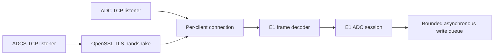

# TCP and ADCS server

[Polski (pl-PL)](../../pl/alpha-0.1/TCP-ADCS.md)

E2 adds two Boost.Asio TCP listeners to `dc24h-hub`. A pool of I/O workers shares one `io_context`. A strand serializes the listeners, the connection registry, and SID allocation. Each accepted socket has its own strand, decoder, protocol state, deadline, and output queue.



The E1 session negotiates `BASE` and `TIGR`, returns `ISUP` and `ISID`, and validates the client's `BINF`. The hub supplies its `IINF` and sends the client's own `BINF` as the final login frame. The reply omits `PD` and uses the connected peer address for an advertised IP field of the matching address family. SID allocation skips zero and releases a slot after its socket closes. [ADC 1.0.4](https://adc.sourceforge.io/ADC.html)

## Configuration

Use `--serve` to start the listeners. E2 takes settings from command-line options. The planned TOML configuration remains part of the roadmap.

| Options | Default and effect |
| --- | --- |
| `--tls-cert FILE`, `--tls-key FILE` | Required PEM certificate chain and matching unencrypted PEM private key. |
| `--adcs-address IP`, `--adcs-port PORT` | ADCS on `127.0.0.1:1511`. |
| `--enable-adc`, `--adc-address IP`, `--adc-port PORT` | Explicitly enables plaintext ADC on `127.0.0.1:1510` by default. |
| `--max-clients COUNT` | 128 active connections across both listeners, including handshakes. |
| `--input-bytes BYTES` | 16,384 bytes per ADC frame before LF. Each read uses at most 4,096 bytes. |
| `--pending-bytes BYTES` | 65,536 queued bytes per session, including the current write. |
| `--setup-timeout-ms MS` | 30,000 ms from TCP accept until the ADC session enters `NORMAL`. |
| `--tls-timeout-ms MS` | 10,000 ms for the TLS handshake, within the overall setup deadline. |
| `--identify-timeout-ms MS` | 15,000 ms from the start of ADC framing until `NORMAL`, within the overall setup deadline. |
| `--idle-timeout-ms MS` | 300,000 ms without a syntactically valid frame or keepalive in `NORMAL`. |
| `--shutdown-timeout-ms MS` | 2,000 ms to drain output and close each session. |
| `--threads COUNT` | Two I/O workers. The range is 1 to 64. |

Specify numeric IPv4 or IPv6 addresses and different ADC and ADCS ports. IPv6 listeners accept IPv6 connections. Port `0` requests an ephemeral port, which the program prints at startup. Buffer limits range from 1 to 1,048,576 bytes and timeouts from 1 ms to 24 hours. E1's parameter count and per-parameter limits still apply.

## TLS and connection handling

The ADCS listener negotiates TLS as its first operation and closes the socket if the handshake fails. OpenSSL accepts TLS 1.2 and later. TLS 1.2 uses ECDHE with AES-GCM or ChaCha20-Poly1305 suites. TLS compression and renegotiation are disabled. Use a trusted chain for the host name clients connect to and keep the private key readable by the hub account. The server checks the credential pair during startup. Keep certificate and key files outside the checkout. [ADC Extensions 1.0.9](https://adc.sourceforge.io/ADC-EXT.html)

The server refuses new connections at capacity, discards malformed frames, and closes sessions that exceed input or output limits. The log records connection, handshake, and close events without recording wire payloads. `SIGINT` and `SIGTERM` stop accepting sockets and initiate session shutdown. Established sessions drain queued writes, send `IQUI` where the protocol state permits it, and exchange TLS close alerts on ADCS. A deadline closes sessions whose peers do not cooperate. The I/O workers exit after the operations complete or are canceled.

## Run and test locally

The following commands create a short-lived certificate for loopback tests. Start the server from the repository root after building the `debug` preset.

```sh
tls_dir=$(mktemp -d)
(
  umask 077
  openssl req -x509 -newkey ec -pkeyopt ec_paramgen_curve:prime256v1 -noenc \
    -days 1 -subj /CN=localhost -addext 'subjectAltName=DNS:localhost,IP:127.0.0.1' \
    -out "$tls_dir/server.pem" -keyout "$tls_dir/server-key.pem"
)
./build/debug/dc24h-hub --serve --adcs-port 0 \
  --tls-cert "$tls_dir/server.pem" --tls-key "$tls_dir/server-key.pem"
```

Run `ctest --preset debug -R '^AdcServer\.'` for the network tests. They generate temporary TLS credentials, use loopback and ephemeral ports, and include two independent ADCS clients that complete both handshakes and close cleanly. `ctest --preset release` runs the full Release suite.

E2 admits guests. User presence, chat, and routing to other clients belong to later stages. The client receives its own `BINF` to complete login.
